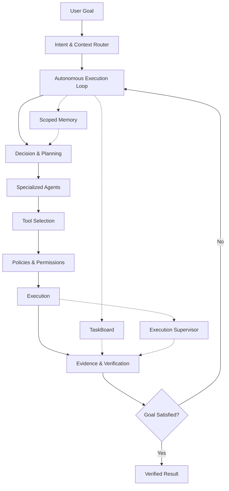

# Mana-Agent

<p align="center">
  
</p>

<p align="center">
  <strong>Think beyond prompts. Build beyond boundaries.</strong>
</p>

<p align="center">
  Your AI-powered execution workspace.<br>
  One goal. Multiple agents. Real tools. Verified results.
</p>

<p align="center">
  <a href="https://www.python.org/"></a>
  <a href="LICENSE"></a>
  
  <a href="https://github.com/manaplatform/mana-agent"></a>
</p>

<p align="center">
  <a href="#quick-start">Get Started</a> ·
  <a href="#what-can-mana-agent-do">Capabilities</a> ·
  <a href="#how-mana-agent-thinks-and-works">Architecture</a> ·
  <a href="#documentation">Documentation</a>
</p>

---

## What if your AI could do more than answer?

Most AI tools stop at the answer.

You ask a question. They generate a response. Then you're left to figure out what to do next.

**Mana-Agent is built for what happens after the answer.**

It can understand your goals, explore your environment, plan actions, coordinate specialized agents, use real tools, and verify outcomes.

Not just for writing code.

For researching, building, debugging, managing, automating, and solving complex tasks across connected systems.

**You define the destination. Mana-Agent helps navigate the journey.**

## Meet Mana-Agent

Mana-Agent is an open-source, Python-based AI agent orchestration platform combining an autonomous execution loop, specialized agents, persistent task management, supervised tool execution, and extensible integrations.

It brings multiple capabilities into one coordinated environment:

- **Understand:** Analyze repositories, documents, APIs, and available evidence before taking action.
- **Decide:** Select suitable models, agents, tools, and execution strategies.
- **Execute:** Use coding tools, browser automation, external services, and connected systems.
- **Coordinate:** Distribute work among specialized agents while tracking dependencies and progress.
- **Remember:** Reuse authorized context, decisions, and lessons across relevant tasks.
- **Verify:** Evaluate actual outcomes rather than treating tool completion as success.
- **Continue:** Replan, recover, or request human intervention when the goal remains unresolved.

The objective is simple:

**Make AI useful not only for thinking about work, but for carrying work through to a trustworthy result.**

## What can Mana-Agent do?

| Your challenge | What Mana-Agent can help with |
|---|---|
| "I don't understand this codebase." | Explore architecture, dependencies, execution flows, and relevant files. |
| "Something is broken." | Investigate symptoms, identify likely causes, propose fixes, and run verification. |
| "I want to build something complex." | Decompose goals, coordinate coding agents, manage dependencies, and review implementation. |
| "This task has too many steps." | Track progress through the autonomous loop, TaskBoard, and execution supervisor. |
| "I need information from an API." | Inspect API documentation, validate requests, and execute supported operations. |
| "I keep repeating this workflow." | Create automations or teach repeatable actions using Teach Mode. |
| "I want AI to work across tools." | Integrate browser, Git, SSH, email, Telegram, protocols, and external services. |
| "What happened during execution?" | Inspect activity, tools, decisions, errors, checkpoints, and artifacts. |

### One interface. Many kinds of work.

```text
> Explain how authentication works in this repository.

> Find why the latest deployment failed.

> Plan and implement a new feature, then run its tests.

> Read this API documentation and help me call the right endpoint.

> Analyze these files and produce an actionable report.

> Break this project into independent tasks and track progress.

> Review previous mistakes before attempting this operation again.
```

Mana-Agent is designed to support both focused questions and multi-step workflows.

---

## Quick Start

### 1. Install

Requires Python 3.10–3.14.

Recommended installation with pipx:

```bash
pipx install git+https://github.com/manaplatform/mana-agent.git
```

Or install directly from the repository:

```bash
git clone https://github.com/manaplatform/mana-agent.git
cd mana-agent

python3 -m venv .venv
source .venv/bin/activate

python -m pip install -e .
```

### 2. Configure

```bash
mana-agent --configure
```

Configure your model provider, credentials, model preferences, and supported capabilities.

### 3. Start

```bash
cd /path/to/your/project
mana-agent
```

You're ready.

Start with a question about your repository, ask for an investigation, or describe something you want to accomplish.

**Your first task doesn't need to be complicated.**

Try:

```text
Analyze this project and explain its architecture,
main components, dependencies, and potential risks.
```

### 4. Explore the dashboard

```bash
mana-agent dashboard --root-dir .
```

The optional dashboard provides another way to interact with Mana-Agent, inspect activity, and manage workflows.

---

## How Mana-Agent thinks and works

Mana-Agent separates **decision-making**, **task organization**, and **execution reliability**.

These are three different responsibilities, working together.

### The architectural triad

| Component | Responsibility |
|---|---|
| **Autonomous Loop** | Decides the next action, evaluates progress, replans when necessary, and determines whether the goal has been satisfied. |
| **TaskBoard** | Maintains task status, subtasks, dependencies, blockers, progress, and verification evidence. |
| **Execution Supervisor** | Manages attempts, leases, heartbeats, checkpoints, cancellation, recovery, and verified completion. |

The autonomous loop drives the process.

TaskBoard supports it.

Execution Supervisor protects its execution lifecycle.

### Execution architecture



### A task isn't complete just because a tool finished.

This distinction matters.

An API request returning HTTP 200 doesn't necessarily mean the intended change happened.

A script exiting successfully doesn't prove the problem was fixed.

A checkbox being marked complete doesn't verify the user's goal.

Mana-Agent distinguishes execution evidence from verified outcomes. When verification fails, its architecture supports replanning, bounded retries, and explicit intervention where necessary.

---

## Specialized agents, working together

Complex problems rarely require only one kind of expertise.

Mana-Agent coordinates specialist agents through a shared execution architecture.

| Agent | Primary role |
|---|---|
| Planner | Decomposes goals and identifies dependencies. |
| Research | Gathers relevant information and evidence. |
| Coding | Implements and modifies code using supported coding tools. |
| Tool | Coordinates structured tool operations. |
| Reviewer | Evaluates implementation quality and potential issues. |
| Verifier | Checks whether requirements and outcomes are satisfied. |
| Summarizer | Produces a clear account of the work and its results. |

Specialists operate within defined permissions, budgets, scopes, and execution boundaries.

Multiple independent tasks may be processed concurrently where safe, while conflicting repository mutations remain coordinated.

Read more in [Multi-Agent Routing](docs/multi-agent-routing.md).

---

## A workspace that remembers context

Repeating the same investigation is frustrating.

So is encountering a problem that was already solved.

Mana-Agent provides memory capabilities to preserve and retrieve relevant knowledge, task context, and execution evidence.

Its memory architecture supports:

- Structured user, project, repository, and task scopes.
- Semantic memory through configurable internal or external providers.
- Versioned memory capsules containing provenance and revision metadata.
- Authorized knowledge sharing between related agents and tasks.
- Review and approval before promoting shared knowledge.
- Memory retention, access controls, and audit boundaries.
- Durable task history and recovery state maintained separately from semantic memory.

Memory isn't treated as permission to access everything.

**Relevant context is useful. Authorized context is essential.**

See [Scoped Memory Capsules](docs/30-scoped-memory-capsules.md) for the supported behavior and limitations.

---

## Tools that turn intentions into actions

Mana-Agent supports a broad tool ecosystem rather than limiting execution to text generation.

### Development and repositories

Repository analysis, code search, Git operations, isolated worktrees, structured changes, automated testing, and supported internal or external coding engines.

### Browser and computer control

Browser navigation, structured page inspection, and permission-controlled computer actions for supported workflows and environments.

### External APIs

Documentation inspection, operation discovery, validated request construction, credential references, approval policies, and protected execution.

### Communication and connectivity

Integrations and protocols including Gmail, Telegram, SSH, MCP, ACP, A2A, and reverse workers.

### Documents and content

Document tools, analysis artifacts, media generation, and Live Canvas capabilities.

### Automation

Scheduled tasks, recurring workflows, reusable integrations, and Teach Mode.

Some capabilities require optional packages, external credentials, configuration, or explicit permissions.

---

## Built for visibility

AI shouldn't require blind trust.

Mana-Agent provides execution visibility across its terminal interface and supported dashboards.

Its activity system separates general operations from coding-specific work.

**Main Activity** tracks orchestration events, tool activity, progress, retries, and errors.

**Coding Activity** tracks file operations, patches, terminal commands, Git operations, tests, and coding results.

Instead of filling the interface with an endless stream of separate cards, activity is grouped into inspectable views.

You can follow what happened, what changed, and what evidence supports the outcome.

## Safety and control

Autonomy without boundaries can produce expensive mistakes.

Mana-Agent's architecture includes:

- Permission gates for consequential actions.
- Constrained repository and tool execution.
- Explicit confirmation for supported high-risk operations.
- Validated external API calls and SSRF protections.
- Credential separation and sensitive-data redaction.
- Bounded execution and resource budgets.
- Durable checkpoints and supervised recovery.
- Controlled retries for ambiguous or non-idempotent actions.
- Verification before reporting completed work.
- Scoped memory authorization and reviewed sharing.

These safeguards do not guarantee that every operation will succeed or that every mistake can be prevented.

They establish clear boundaries around what the system may attempt and how results are evaluated.

Read [Resilient Execution](docs/29-resilient-execution.md) and [Policy-Gated Actions](docs/31-policy-gated-transactional-actions.md).

---

## Performance and resource awareness

More tool calls don't automatically produce better results.

Mana-Agent includes mechanisms to help control the cost and complexity of agent execution.

- Adaptive model and agent routing.
- Context and token budget visibility.
- Lazy tool-schema loading.
- Evidence-ledger reuse and duplicate-read reduction.
- Bounded specialist delegation.
- Lossless-backed compression of large tool results.
- Configurable context and cost limits.
- Execution traces and resource reporting.

Inspect your recent context and cost usage:

```bash
mana-agent context report --since 7d
```

Learn more in [Adaptive Coding Runtime](docs/adaptive-coding-runtime.md) and [Model Routing](docs/model-routing.md).

---

## Command Reference

| Command | Purpose |
|---|---|
| `mana-agent` | Start interactive chat. |
| `mana-agent --configure` | Configure Mana-Agent. |
| `mana-agent doctor` | Diagnose installation and configuration. |
| `mana-agent analyze .` | Analyze the current repository. |
| `mana-agent ask "question" --root-dir .` | Ask a repository-grounded question. |
| `mana-agent dashboard --root-dir .` | Launch the optional dashboard. |
| `mana-agent git -- status` | Inspect repository status. |
| `mana-agent context report --since 7d` | Review context and cost usage. |
| `mana-agent tasks list --incomplete` | List incomplete durable tasks. |
| `mana-agent tasks status <task-id>` | Inspect task state. |

The CLI also exposes `mana-agent runs ...` for durable execution task operations.

### Interactive chat commands

```text
/analyze
/tasks
/models
/route explain
```

See [Commands](docs/04-commands.md) for the complete reference.

---

## Optional Capabilities

Install the components you need.

```bash
# Dashboard
python -m pip install -e ".[dashboard]"

# Automations
python -m pip install -e ".[automations]"

# Observability
python -m pip install -e ".[observability]"

# Communication protocols
python -m pip install -e ".[protocols]"
```

Install the combined optional dependency set:

```bash
python -m pip install -e ".[full]"
```

For browser automation:

```bash
python -m playwright install chromium
```

Consult the individual capability documentation for configuration and platform requirements.

---

## Configuration

Mana-Agent stores normal configuration and protected credentials separately.

```text
~/.mana/
├── config.toml
└── secrets.toml
```

Start the configuration wizard:

```bash
mana-agent --configure
```

The configuration system supports model providers, routing preferences, integrations, permissions, execution controls, memory settings, and optional capability configuration.

Full reference: [Configuration Guide](docs/05-configuration.md).

---

## Documentation

| Guide | Description |
|---|---|
| [Overview](docs/01-overview.md) | Introduction and concepts |
| [Installation](docs/02-installation.md) | Setup and dependencies |
| [Quick Start](docs/03-quick-start.md) | First steps |
| [Commands](docs/04-commands.md) | CLI and command reference |
| [Architecture](docs/08-architecture.md) | Internal architecture |
| [Multi-Agent Routing](docs/multi-agent-routing.md) | Specialist orchestration |
| [Adaptive Coding Runtime](docs/adaptive-coding-runtime.md) | Coding execution |
| [Resilient Execution](docs/29-resilient-execution.md) | Durable supervision and recovery |
| [Memory Capsules](docs/30-scoped-memory-capsules.md) | Scoped memory and sharing |
| [API Manager](docs/api-manager.md) | External API integration |
| [Browser Automation](docs/17-browser-automation.md) | Browser capabilities |
| [Computer Control](docs/22-computer-control.md) | Desktop interaction |
| [Teach Mode](docs/26-teach-mode.md) | Reusable workflows |
| [Automations](docs/27-automations.md) | Scheduled execution |
| [Live Canvas](docs/live-canvas.md) | Interactive workspace capabilities |
| [Connector Health](docs/33-connector-health.md) | Integration diagnostics |

Browse the complete [documentation directory](docs/).

---

## Development

Clone the repository and install the development environment.

```bash
git clone https://github.com/manaplatform/mana-agent.git
cd mana-agent

python3 -m venv .venv
source .venv/bin/activate

python -m pip install -e ".[full]"
python -m pip install pytest ruff mypy
```

Run the checks:

```bash
pytest -q
ruff check src tests
mypy src tests
```

Contributions, bug reports, documentation improvements, and architectural discussions are welcome.

See [CONTRIBUTING.md](CONTRIBUTING.md) and [CODE_OF_CONDUCT.md](CODE_OF_CONDUCT.md).

## Philosophy

**An intelligent system should know the difference between an answer, an action, and a result.**

Mana-Agent is developed around five principles:

1. **Understand before acting.** Gather evidence and identify the actual goal.
2. **Choose the right tools.** Different problems deserve different approaches.
3. **Keep execution observable.** Make progress, decisions, and failures inspectable.
4. **Learn from experience.** Preserve useful knowledge without weakening trust boundaries.
5. **Verify before claiming success.** Completion should be supported by evidence.

The ambition is not to remove humans from the process.

It is to make collaboration between humans, AI models, tools, and specialized agents more capable, transparent, and productive.

---

## License

Mana-Agent is open source under the [MIT License](LICENSE).

---

<p align="center">
  <strong>Mana-Agent</strong><br>
  <em>From intention to execution. From execution to evidence.</em>
</p>

<p align="center">
  <a href="#quick-start">Get Started</a> ·
  <a href="https://github.com/manaplatform/mana-agent">GitHub</a> ·
  <a href="https://github.com/manaplatform/mana-agent/issues">Report an Issue</a> ·
  <a href="docs/">Explore the Docs</a>
</p>

<p align="center">
  <strong>Have a goal in mind? Start with Mana.</strong>
</p>