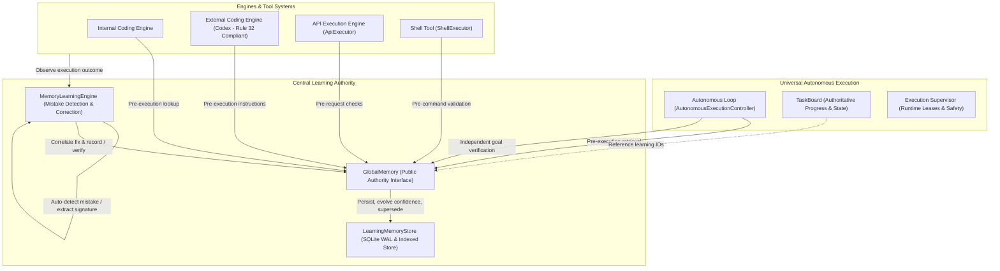

# Global Self-Learning Memory System

Mana-Agent incorporates a centralized, persistent **Global Self-Learning Memory System** (`GlobalMemory`). It empowers Mana-Agent to automatically observe execution outcomes, detect mistakes across every action type, determine root causes, store verified corrections, evolve confidence through reinforcement, and retrieve relevant prevention rules before executing future tasks.

> **Primary Principle:**
> If Mana-Agent makes a mistake, discovers why it happened, and learns how to avoid it, that knowledge remains permanently available to every relevant agent, engine, tool, and future execution.

---

## 1. Architectural Authority

The system reinforces the **Architectural Quad**:

1. **Autonomous Loop (`AutonomousExecutionController`)**: Execution and decision brain.
2. **TaskBoard (`TaskBoard`)**: Single source of truth for task status, progress, subtasks, dependencies, blockers, and verification records. References learning memory IDs via `learning_references` without duplicating the memory store.
3. **Execution Supervisor (`ExecutionSupervisor`)**: Runtime authority for leases, attempts, heartbeat, checkpoints, cancellation, and recovery.
4. **GlobalMemory (`GlobalMemory`)**: Persistent authority for learned mistakes, corrections, and reusable execution knowledge.



---

## 2. Automatic Mistake Detection & Classification

The `MemoryLearningEngine` continuously observes execution outputs without requiring manual intervention:

- **Mistake Types Detected**:
  - Terminal command typos and syntax errors (e.g. `npm run bulid` -> `npm run build`, `python -m pyetst` -> `python -m pytest`).
  - Failed builds, compiler errors, and broken test suites.
  - Invalid API parameters, missing authorization headers, and 4xx status codes.
  - Tool invocation schema violations and missing file paths.
  - Ineffective approaches, failed plans, and failed independent verifications.
- **Transient vs. Real Mistakes**:
  - Transient failures (e.g., HTTP 502/503/504, connection timeouts, rate limits, user-initiated cancellations) are distinguished and filtered out so they do not become persistent rules.
- **Unverified Hypotheses**:
  - Failures where the root cause or correction cannot be definitively verified are stored as `CANDIDATE` with `is_hypothesis=True`. They are never presented as established facts until verified with empirical evidence.

---

## 3. Persistent Memory Schema

Learned memories are stored in an ACID SQLite database in WAL mode at `~/.mana/memory/global_learning.sqlite3` (or `$MANA_HOME/memory/global_learning.sqlite3`):

```python
class LearningCategory(str, Enum):
    CODING = "CODING"
    API = "API"
    TOOL = "TOOL"
    COMMAND = "COMMAND"
    REASONING = "REASONING"
    PLANNING = "PLANNING"
    EXECUTION = "EXECUTION"
    ENVIRONMENT = "ENVIRONMENT"
    GENERAL = "GENERAL"

class LearningScope(str, Enum):
    GLOBAL = "GLOBAL"
    PROJECT = "PROJECT"
    TASK = "TASK"
    ENVIRONMENT = "ENVIRONMENT"

class LearningStatus(str, Enum):
    CANDIDATE = "CANDIDATE"
    VERIFIED = "VERIFIED"
    DISPUTED = "DISPUTED"
    SUPERSEDED = "SUPERSEDED"
```

Each `LearningMemory` record contains:
- `id`: Unique identifier.
- `category` & `scope`: Classification and visibility boundaries.
- `attempted_action` & `failure_signature`: Normalized signature for exact-match retrieval.
- `error`, `root_cause`, `correction`, `prevention_rule`: Diagnostic context and actionable directive.
- `status` & `confidence`: Lifecycle state and probability score (adjusted by verification).
- `success_count` & `failure_count`: Outcome counters.
- `evidence_references` & `provenance`: Traceable verification references.
- `project_id` & `environment_fingerprint`: Scoped tenancy barriers.

---

## 4. Pre-Execution Retrieval Flow

Before running commands, planning goals, executing API requests, or invoking tools:

1. **Retrieval**: `GlobalMemory.retrieve_relevant(...)` queries indexed signatures and tokenized keywords, bounded to top-k entries (default 5).
2. **Context Injection**: Past learnings are formatted into concise markdown instructions (`## Past Learnings & Prevention Rules`).
3. **Engine-Specific Integration**:
   - **Internal Coding Engine**: Injected into turn instructions and system prompts.
   - **External Coding Engine (Codex)**: Pre-turn injection into `task.user_request` conforming strictly to Rule 32 without intercepting Codex's inner tool selection loop.
   - **API & Shell Tools**: Validated before network dispatch or process execution.

---

## 5. Scope Governance and Evolution

- **Project Isolation**: Rules learned within `repo_alpha` with `scope="PROJECT"` never leak into `repo_beta`.
- **Evidence-Based Global Promotion**: When a project rule is verified multiple times across independent runs and contains no repo-specific file paths, it is automatically promoted to `GLOBAL`.
- **Confidence Adjustment**:
  - Verified successes increase confidence (+0.2 up to 1.0) and transition `CANDIDATE` to `VERIFIED`.
  - Failed applications decrease confidence (-0.25). If confidence drops below 0.35, the rule transitions to `DISPUTED`.
- **Supersession**: Obsolete rules can be superseded by newer rules, linking `superseded_by` and `replaces_memory_id` while retaining full audit history.
- **Safety**: Passwords, API tokens, and private keys are scrubbed before persistence using regex pattern matching and `redact_secrets`.
